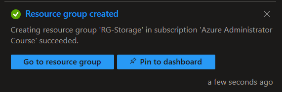

# Lab 07 – Storage Accounts

## 🎯 Objective

Deploy and configure an Azure Storage Account, explore storage redundancy options, work with Blob Storage and Azure Files, and generate Shared Access Signatures (SAS) to provide controlled access to storage resources.

This lab demonstrates:

- Creating an Azure Storage Account.
- Configuring storage account security settings.
- Understanding storage redundancy options.
- Submitting a redundancy conversion from LRS to ZRS.
- Creating Blob Storage containers.
- Uploading and managing blobs.
- Exploring Blob access tiers.
- Creating and configuring Azure File Shares.
- Uploading files to Azure Files.
- Generating SAS tokens for delegated access.
- Understanding storage costs and security considerations.

---

## Prerequisites

- Azure subscription.
- Azure Portal access.
- Basic understanding of Azure Resource Groups.
- Basic understanding of Azure storage concepts.

---

## Technologies

- Azure Storage Accounts
- Azure Blob Storage
- Azure Files
- Azure Storage Redundancy
- Shared Access Signatures (SAS)
- Azure Portal

---

## Lab Tasks

1. Create a dedicated Resource Group.
2. Deploy a Storage Account.
3. Configure security and networking settings.
4. Explore storage redundancy options.
5. Submit an LRS-to-ZRS conversion.
6. Create a Blob Storage container.
7. Upload and inspect blobs.
8. Explore Blob access tiers.
9. Create an Azure File Share.
10. Upload and inspect files.
11. Generate a read-only SAS token.
12. Test delegated access.
13. Review storage costs and security considerations.

---

## 🏗️ Architecture

The lab uses a dedicated Resource Group containing a General-purpose v2 Storage Account.

```text
Azure Subscription
│
└── RG-Storage
      │
      └── azlabstorage2026
            │
            ├── Blob Storage
            │     │
            │     └── Container: lab-files
            │           │
            │           └── 8-Container-Created.png
            │
            └── Azure Files
                  │
                  └── File Share: lab-share
                        │
                        └── 8-Container-Created.png
```

### Storage Account Configuration

| Setting | Value |
|---|---|
| Resource Group | `RG-Storage` |
| Storage Account | `azlabstorage2026` |
| Region | South Africa North |
| Performance | Standard |
| Account Kind | StorageV2 (General-purpose v2) |
| Initial Redundancy | LRS |
| Final Redundancy | ZRS |
| Default Access Tier | Hot |
| Minimum TLS Version | 1.2 |
| Secure Transfer | Enabled |
| Anonymous Container Access | Disabled |

---

# 🚀 Lab Steps

## Step 1 – Create a Resource Group

Created a dedicated Resource Group to organize the storage resources.

| Setting | Value |
|---|---|
| Resource Group | `RG-Storage` |
| Region | South Africa North |



## Step 2 – Create the Storage Account

Created a new Storage Account with the following configuration:

| Setting | Value |
|---|---|
| Storage Account Name | `azlabstorage2026` |
| Resource Group | `RG-Storage` |
| Region | South Africa North |
| Performance | Standard |
| Account Kind | StorageV2 |
| Redundancy | LRS |

### 💡 Interesting Observation

General-purpose v2 Storage Accounts support multiple Azure storage services, including:

- Blob Storage
- Azure Files
- Queue Storage
- Table Storage

This makes StorageV2 suitable for general-purpose storage workloads.


## Step 3 – Configure Advanced Settings

Configured the Storage Account security settings.

| Setting | Configuration |
|---|---|
| Require Secure Transfer | Enabled |
| Anonymous Container Access | Disabled |
| Minimum TLS Version | 1.2 |
| Hierarchical Namespace | Disabled |
| Default Access Tier | Hot |

### 💡 Interesting Observation

Disabling anonymous container access prevents containers from being configured for public anonymous access.

Storage Account access can still be provided through authorized methods such as account keys, Microsoft Entra ID and SAS tokens.

image/png

## Step 4 – Configure Networking

Configured the initial networking settings.

| Setting | Configuration |
|---|---|
| Public Network Access | Enabled |
| Network Access Scope | All Networks |

This configuration allows access through the public endpoint, subject to the Storage Account's authentication and authorization requirements.

image/png

## Step 5 – Review and Deploy

Reviewed the configuration and deployed the Storage Account.

Azure confirmed that provisioning succeeded.

image/png

### Storage Account Overview

The deployed account showed:

- StorageV2 (General-purpose v2).
- Standard performance.
- South Africa North region.
- LRS redundancy.

image/png

---

# 🧪 Experiments

## Experiment 1 – Explore Storage Redundancy

Opened the Storage Account's Redundancy configuration to investigate the available replication options.

The following options were displayed:

| Redundancy | Availability | Description |
|---|---|---|
| LRS | Available | Three copies within a single physical location. |
| GRS | Available | Local redundancy in the primary region and asynchronous replication to a secondary region. |
| RA-GRS | Available | GRS with read access to the secondary region. |
| ZRS | Available | Synchronous replication across availability zones in the primary region. |
| GZRS | Unavailable | Combines zone redundancy in the primary region with geo-replication. |
| RA-GZRS | Unavailable | GZRS with read access to the secondary region. |

image/png

### 💡 Interesting Observation

Not every redundancy option is available for every Storage Account configuration or Azure region.

For this Storage Account in South Africa North, GZRS and RA-GZRS were greyed out.

This demonstrates the importance of checking regional service availability before designing a storage solution.

---

## Experiment 2 – Convert LRS to ZRS

The Storage Account was initially configured with Locally Redundant Storage (LRS).

I selected Zone-Redundant Storage (ZRS) to investigate the conversion process.

Azure displayed a confirmation warning explaining that:

- The conversion typically starts within a few days after validation.
- The process can take several weeks depending on regional demand, account size and other factors.
- The conversion cannot be stopped once initiated.
- Storage data remains accessible during conversion, without loss of durability or availability.

image/png

### Conversion Submitted

After confirming the change, Azure displayed:

```text
From: Locally redundant storage (LRS)
To:   Zone-redundant storage (ZRS)

Status: Submitted for conversion
```

image/png

### 💡 Interesting Observation

Changing storage redundancy is not necessarily an immediate operation.

Azure performs the conversion asynchronously. The account remains accessible while the conversion takes place.

The Azure Files Overview page subsequently displayed ZRS as its redundancy configuration.

This demonstrates that redundancy conversion can take time and should be considered when planning production storage changes.

---

## Experiment 3 – Create a Blob Storage Container

Navigated to:

```text
Storage Account
    → Data Storage
        → Containers
```

Created a new container.

| Setting | Value |
|---|---|
| Container Name | `lab-files` |
| Anonymous Access Level | Private |

The container was successfully created.

image/png

### 💡 Interesting Observation

Blob containers organize related objects inside a Storage Account.

The Private access level prevents anonymous public access to the container.

A system-created `$logs` container was also visible. This was left unchanged.

---

## Experiment 4 – Upload and Inspect a Blob

Uploaded the following file into `lab-files`:

```text
8-Container-Created.png
```

The uploaded object was stored as a Block Blob.

### Blob Properties

| Property | Observed Value |
|---|---|
| Blob Name | `8-Container-Created.png` |
| Blob Type | Block Blob |
| Size | 34.08 KiB |
| Initial Access Tier | Hot (Inferred) |
| Server Encrypted | True |
| Content Type | `image/png` |
| Lease Status | Unlocked |
| Lease State | Available |

image/png

### 💡 Interesting Observations

**1. Block Blob**

Block blobs are designed for general-purpose unstructured data, including images, documents, videos and backups.

**2. Hot (Inferred)**

The uploaded blob initially inherited the Hot access tier from the Storage Account's default configuration.

**3. Server Encrypted**

Azure automatically encrypts stored data at rest.

**4. Content Type**

Azure identified the uploaded file as `image/png`.

Content type metadata helps applications understand how to handle stored objects.

---

## Experiment 5 – Explore Blob Access Tiers

Opened the uploaded blob and selected Change tier.

The following options were displayed:

| Access Tier | Availability |
|---|---|
| Hot | Available |
| Cool | Available |
| Cold | Available |
| Archive | Unavailable |
| Smart | Unavailable |

Azure displayed the following message:

```text
Archive is not supported for this storage account configuration.
```

image/png

### Change Hot to Cool

Changed the individual blob's access tier from Hot to Cool.

The updated properties showed:

| Property | Before | After |
|---|---|---|
| Blob Type | Block Blob | Block Blob |
| Access Tier | Hot (Inferred) | Cool |
| Size | 34.08 KiB | 34.08 KiB |

image/png

### 💡 Interesting Observations

**1. Individual Blob Tiering**

An individual blob can have its own access tier.

Changing one blob's tier does not automatically change the Storage Account's default access tier.

**2. Archive Availability**

Archive was unavailable for this ZRS Storage Account configuration.

Archive is supported with LRS, GRS and RA-GRS, but not ZRS.

**3. Cold Tier**

Cold was available and provides another option for data that is accessed less frequently.

**4. Access Tier Trade-offs**

Different access tiers have different storage prices, transaction costs and minimum retention periods.

---

## Experiment 6 – Create an Azure File Share

Navigated to:

```text
Storage Account
    → Data Storage
        → File Shares
```

Created a new File Share.

| Setting | Value |
|---|---|
| File Share Name | `lab-share` |
| Access Tier | Transaction Optimized |
| Quota | 1 GiB |

The File Share was successfully created.

image/png

### 💡 Interesting Observation

Azure Files provides managed file shares that can be accessed using standard file-sharing protocols such as SMB.

Unlike Blob Storage, which uses containers and objects, Azure Files provides a traditional file-system experience.

---

## Experiment 7 – Upload a File to Azure Files

Uploaded the same file used in the Blob Storage experiment:

```text
8-Container-Created.png
```

Initially, I was viewing the File Share Overview page, which displays configuration and capacity information rather than the actual directory contents.

Navigating to **Browse** displayed the uploaded file.

### File Properties

| Property | Observed Value |
|---|---|
| File Share | `lab-share` |
| File Name | `8-Container-Created.png` |
| Type | File |
| Size | 34.08 KiB |
| Authentication Method | Access key |
| Redundancy | ZRS |

image/png

### 💡 Interesting Observations

**1. Browse vs Overview**

The Overview page displays the File Share's configuration and capacity.

The Browse page displays the actual files and directories.

**2. Authentication Method**

The Azure Portal displayed Access key as the authentication method when browsing the File Share.

Azure Files also supports identity-based authentication through supported identity providers and configurations.

**3. Storage Redundancy**

The File Share Overview displayed Zone-redundant storage (ZRS).

---

## Experiment 8 – Compare Blob Storage and Azure Files

The same image was uploaded to both storage services.

| Feature | Blob Storage | Azure Files |
|---|---|---|
| Resource | `lab-files` | `lab-share` |
| Uploaded File | `8-Container-Created.png` | `8-Container-Created.png` |
| Storage Model | Object Storage | File Storage |
| Organization | Containers and Blobs | Shares and Directories |
| Access | REST API / SDK | SMB / NFS |
| Common Usage | Images, videos, backups | Shared folders and application data |
| File System Experience | Object-based | Traditional file-share experience |

### 💡 Interesting Observation

Although both services can store files, they are designed for different workloads.

Blob Storage is optimized for unstructured object data, while Azure Files provides managed file shares that can be mounted and accessed by multiple clients.

---

## Experiment 9 – Generate a Shared Access Signature (SAS)

Generated a Shared Access Signature for the uploaded Blob.

The purpose was to provide temporary, restricted access without sharing the Storage Account access key.

### SAS Configuration

| Setting | Configuration |
|---|---|
| Resource | Individual Blob |
| Signing Method | Account Key |
| Signing Key | Key 1 |
| Permissions | Read |
| Start Time | 15 minutes before current time |
| Expiry | 1 hour after current time |
| Allowed Protocols | HTTPS only |

image/png

### 💡 Interesting Observation

A SAS token provides delegated access to a storage resource.

The token defines:

- Which resource can be accessed.
- Which permissions are allowed.
- When access becomes valid.
- When access expires.
- Which protocols can be used.

A SAS URL must be treated as sensitive information because anyone possessing a valid URL can exercise the permissions it grants.

**Important:** SAS tokens and Storage Account keys should never be published in GitHub repositories.

---

## Experiment 10 – Troubleshoot SAS Authentication

During the initial SAS testing, the browser returned:

```text
AuthenticationFailed

Signature did not match.
```

The Azure error details referenced:

```text
/blob/azlabstorage2026/$root
```

This indicated that the request was targeting the `$root` container rather than the intended Blob.

The intended resource was:

```text
Storage Account:
azlabstorage2026

Container:
lab-files

Blob:
8-Container-Created.png
```

The SAS URL was regenerated and the correct Blob SAS URL was used.

### 💡 Interesting Observation

A SAS URL is resource-specific.

Generating a SAS for the wrong resource or using an incorrectly constructed URL can result in an authentication failure, even when the permissions and signing key are otherwise correct.

---

# 💰 Cost Considerations

Azure Storage Accounts do not have a basic fixed account creation charge. Costs depend on storage consumption, redundancy, transactions, performance tiers and data transfer.

| Component | Cost Consideration |
|---|---|
| Storage Account | No basic account creation charge |
| Blob Storage | Storage capacity, transactions and data transfer |
| Azure Files | Stored capacity, transactions and selected performance tier |
| LRS | Generally the lowest-cost redundancy option |
| ZRS | Generally more expensive than LRS |
| GRS / RA-GRS | Additional geographic replication costs |
| SAS | No separate charge for generating a SAS token |

### Storage Redundancy

Higher redundancy options generally provide additional protection but come at a higher storage cost.

The appropriate option depends on:

- Availability requirements.
- Durability requirements.
- Disaster recovery requirements.
- Regional availability.
- Budget.

### Access Tiers

Hot, Cool, Cold and Archive have different storage and access cost structures.

Choosing an appropriate tier depends on how frequently data is accessed and how long it needs to be retained.

Minimum retention periods and early deletion charges should also be considered.

---

# 🛠️ Troubleshooting

## Blob SAS URL Returns AuthenticationFailed

**Error:**

```text
AuthenticationFailed
Signature did not match.
```

**Possible causes:**

- Incorrect SAS URL.
- Incorrect resource path.
- Incorrect signing key.
- Invalid or expired SAS token.
- URL query parameters modified or truncated.

**Resolution:**

Regenerate the SAS token from the intended Blob and copy the complete Blob SAS URL, including its query string.

Verify that the resource path points to:

```text
/blob/azlabstorage2026/lab-files/8-Container-Created.png
```

Never share the SAS token when troubleshooting.

---

## Azure Files Upload Not Visible

Initially, the uploaded file was not visible because the File Share Overview page was open.

**Resolution:**

1. Open the File Share.
2. Select Browse.
3. Refresh the directory listing.
4. Confirm the uploaded file appears.

The Overview page displays configuration information, while Browse displays the actual file contents.

---

# 📚 Lessons Learned

- StorageV2 supports multiple Azure storage services.
- Storage Accounts can use different redundancy configurations depending on regional and service availability.
- LRS maintains three copies within a single physical location.
- ZRS replicates data synchronously across availability zones.
- GRS and RA-GRS provide geographic replication.
- Storage redundancy conversion can be asynchronous and may take several days or weeks.
- Blob Storage is designed for unstructured object storage.
- Block blobs are suitable for general-purpose file and object storage.
- Individual blobs can have different access tiers.
- Hot, Cool and Cold are designed for different data access patterns.
- Archive is not supported with ZRS.
- Azure Files provides managed file shares using SMB and supported NFS configurations.
- Blob Storage and Azure Files serve different storage requirements.
- Azure automatically encrypts stored data at rest.
- SAS tokens provide temporary, permission-limited access without sharing Storage Account keys.
- SAS URLs must be protected because possession of a valid URL grants its configured permissions.
- Storage costs depend on redundancy, capacity, transactions, access tier and data transfer.

---

# 📌 Key AZ-104 Exam Notes

## Storage Account Types

| Account Type | Purpose |
|---|---|
| General-purpose v2 | Supports Blob, Files, Queues and Tables |
| BlockBlobStorage | Premium block blob workloads |
| FileStorage | Premium Azure Files workloads |
| Premium page blobs | High-performance page blob workloads |

## Storage Redundancy

| Redundancy | Key Concept |
|---|---|
| LRS | Three copies within one physical location |
| ZRS | Synchronous replication across availability zones |
| GRS | LRS in primary region plus asynchronous replication to secondary region |
| RA-GRS | GRS with read access to secondary region |
| GZRS | ZRS in primary region plus geo-replication |
| RA-GZRS | GZRS with read access to secondary region |

## Blob Access Tiers

| Tier | Intended Usage |
|---|---|
| Hot | Frequently accessed data |
| Cool | Infrequently accessed data |
| Cold | Rarely accessed data |
| Archive | Offline storage for rarely accessed data |

## Azure Files vs Blob Storage

| Feature | Blob Storage | Azure Files |
|---|---|---|
| Storage Model | Object | File |
| Organization | Containers | File Shares |
| Access | REST API / SDK | SMB / NFS |
| Common Use | Unstructured data | Shared file systems |

## Shared Access Signatures (SAS)

| Concept | Key Point |
|---|---|
| Purpose | Delegate access to storage resources |
| Permissions | Read, Write, Delete, List and others depending on resource |
| Expiry | SAS tokens can have a defined validity period |
| Protocol | HTTPS can be enforced |
| Security | Anyone possessing a valid SAS URL can use its granted permissions |
| Account Key | Does not need to be shared with the SAS recipient |

### Important Distinction

```text
Storage Account Key
        ↓
Broad access to storage account

Shared Access Signature
        ↓
Restricted, delegated access
        ↓
Specific resource + permissions + validity period
```

---

# References

- [Microsoft Learn – Introduction to Azure Storage](https://learn.microsoft.com/azure/storage/common/storage-introduction)
- [Microsoft Learn – Create a Storage Account](https://learn.microsoft.com/azure/storage/common/storage-account-create)
- [Microsoft Learn – Azure Storage Redundancy](https://learn.microsoft.com/azure/storage/common/storage-redundancy)
- [Microsoft Learn – Storage Account Conversion](https://learn.microsoft.com/azure/storage/common/redundancy-migration)
- [Microsoft Learn – Azure Blob Storage Introduction](https://learn.microsoft.com/azure/storage/blobs/storage-blobs-introduction)
- [Microsoft Learn – Blob Access Tiers](https://learn.microsoft.com/azure/storage/blobs/access-tiers-overview)
- [Microsoft Learn – Azure Files Introduction](https://learn.microsoft.com/azure/storage/files/storage-files-introduction)
- [Microsoft Learn – Create an Azure File Share](https://learn.microsoft.com/azure/storage/files/storage-how-to-create-file-share)
- [Microsoft Learn – Create a Service SAS](https://learn.microsoft.com/azure/storage/common/storage-service-sas-create-dotnet)
- [Microsoft Learn – Azure Storage SAS Overview](https://learn.microsoft.com/azure/storage/common/storage-sas-overview)
- [Microsoft Azure – Storage Pricing](https://azure.microsoft.com/pricing/details/storage/)

