# Lab 08 – Managed Disks & Snapshots

## 🎯 Objective

Create and manage Azure Managed Disks, attach data disks to Azure Virtual Machines, initialise and format disks in Linux, create snapshots, and restore managed disks from snapshots.

This lab demonstrates:

- Creating a dedicated Resource Group.
- Deploying an Ubuntu Linux Virtual Machine.
- Creating Azure Managed Disks.
- Attaching data disks to Virtual Machines.
- Identifying Linux block devices.
- Creating disk partitions using `fdisk`.
- Formatting partitions using the ext4 filesystem.
- Mounting and managing disk storage in Linux.
- Creating point-in-time managed disk snapshots.
- Creating new managed disks from snapshots.
- Detaching and reattaching managed disks.
- Verifying snapshot recovery.
- Comparing Managed Disk Snapshots with Azure Backup.
- Understanding storage costs and recovery considerations.

## Prerequisites

- Azure subscription.
- Azure Portal access.
- Basic understanding of Azure Resource Groups.
- Basic understanding of Azure Virtual Machines.
- Basic Linux command-line knowledge.
- SSH access to a Linux Virtual Machine.

## Technologies

- Azure Virtual Machines
- Azure Managed Disks
- Azure Managed Disk Snapshots
- Azure Resource Groups
- Ubuntu Linux
- Linux disk partitioning (`fdisk`)
- Linux filesystems (`ext4`)
- Linux disk mounting (`mount`)
- SSH
- Azure Portal

## Lab Tasks

- Create a dedicated Resource Group.
- Deploy an Ubuntu Linux Virtual Machine.
- Create a managed data disk.
- Attach the data disk to the VM.
- Identify the disk in Linux.
- Create a partition and filesystem.
- Mount and test the disk.
- Create a managed disk snapshot.
- Create a new managed disk from the snapshot.
- Attach the restored disk to the VM.
- Verify recovery of the original data.
- Compare snapshots with Azure Backup.
- Review storage costs and recovery considerations.

## 🏗️ Architecture

The lab uses a dedicated Resource Group containing an Ubuntu Virtual Machine, an original managed data disk, a snapshot and a restored managed disk.
```
Azure Subscription
│
└── RG-Disks
    │
    ├── DiskLab-VM01
    │   │
    │   ├── OS Disk
    │   │
    │   └── Attached Data Disk
    │       │
    │       └── DiskLab-DataDisk01
    │
    ├── DiskLab-Snapshot01
    │   │
    │   └── Source: DiskLab-DataDisk01
    │
    └── DiskLab-RestoredDisk01
        │
        └── Created from DiskLab-Snapshot01
```
## Managed Disk Configuration

| Setting | Value |
|---|---|
| Resource Group | RG-Disks |
| Virtual Machine | DiskLab-VM01 |
| Operating System | Ubuntu Server 24.04 LTS |
| Region | South Africa North |
| Original Data Disk | DiskLab-DataDisk01 |
| Original Disk Size | 32 GiB |
| Original Disk Type | Standard SSD |
| Snapshot | DiskLab-Snapshot01 |
| Restored Disk | DiskLab-RestoredDisk01 |
| Restored Disk Size | 32 GiB |
| Restored Disk Type | Standard SSD LRS |
| Filesystem | ext4 |

## 🚀 Lab Steps

### Step 1 – Create a Resource Group

Created a dedicated Resource Group to organise the resources for the managed disk lab.

| Setting | Value |
|---|---|
| Resource Group | RG-Disks |
| Region | South Africa North |


### Step 2 – Create a Linux Virtual Machine

Deployed a new Ubuntu Linux Virtual Machine because the Linux VM from the previous networking labs was no longer available.

| Setting | Value |
|---|---|
| VM Name | DiskLab-VM01 |
| Resource Group | RG-Disks |
| Region | South Africa North |
| Operating System | Ubuntu Server 24.04 LTS |
| Authentication | SSH Public Key |

The VM was deployed with a new virtual network and public IP configuration.

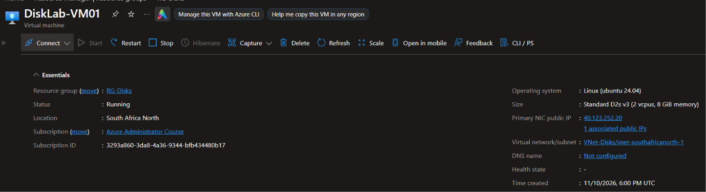

### Step 3 – Create a Managed Data Disk

Created a separate Azure Managed Disk that would be attached to the Linux VM.

| Setting | Value |
|---|---|
| Disk Name | DiskLab-DataDisk01 |
| Resource Group | RG-Disks |
| Region | South Africa North |
| Disk Size | 32 GiB |
| Storage Type | Standard SSD |
| Source Type | None |

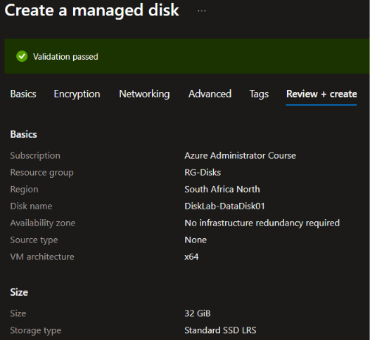

The disk was created independently of the Virtual Machine and was initially unattached.

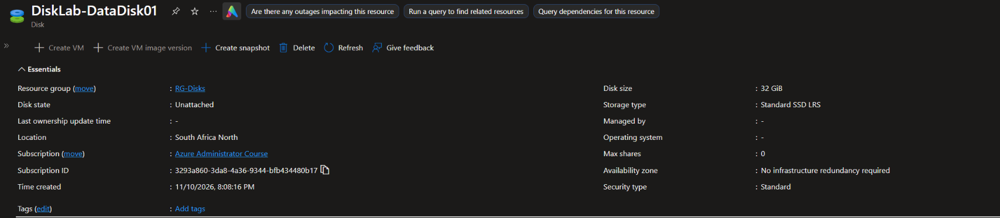

### Step 4 – Attach the Data Disk

Attached `DiskLab-DataDisk01` to `DiskLab-VM01` through:

Virtual Machines
    → DiskLab-VM01
        → Settings
            → Disks
                → Attach existing disks

Azure assigned the disk a Logical Unit Number (LUN).

Once attached, the disk became available to the Linux operating system as a block storage device.

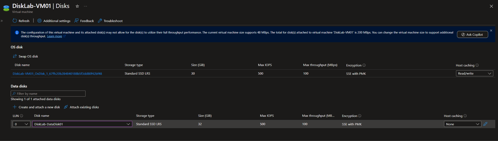

## 🧪 Experiments

### Experiment 1 – Identify Linux Block Devices

Connected to the VM using SSH and ran:

```bash
lsblk
```

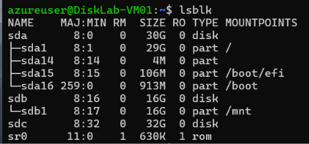

The command displays block devices, including disks and partitions recognised by Linux.

The initial output showed:

| Device | Size | Purpose |
|---|---:|---|
| `/dev/sda` | 30 GB | OS disk |
| `/dev/sdb` | 16 GB | Existing resource disk |
| `/dev/sdc` | 32 GB | New managed data disk |

The new managed disk was identified as `/dev/sdc`.

💡 Interesting Observation

Azure Managed Disks are presented to the guest operating system as block devices.

Linux assigns device names such as `/dev/sda`, `/dev/sdb` and `/dev/sdc`.

These device names can change when disks are detached and reattached. It is important to identify the correct disk before performing partitioning or formatting operations.

### Experiment 2 – Create a Disk Partition

Used the Linux `fdisk` utility to create a partition on the new managed disk.

Command:

```bash
sudo fdisk /dev/sdc
```

Commands entered inside fdisk:

```text
n
p
1
Enter
Enter
w
```

Command explanations:

| Input | Purpose |
|---|---|
| `n` | Create a new partition |
| `p` | Select primary partition |
| `1` | Assign partition number 1 |
| Enter | Accept default first sector |
| Enter | Accept default last sector |
| `w` | Write changes and exit |

This created the partition:

```text
/dev/sdc
└── /dev/sdc1
```

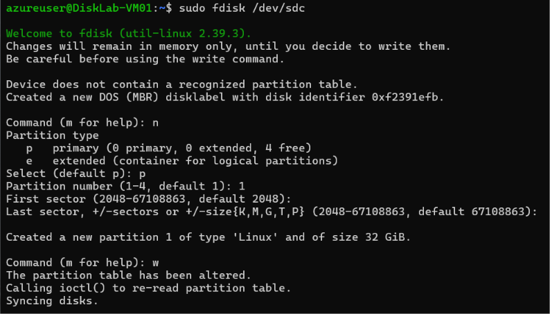

💡 Interesting Observation

A managed disk and a partition are different things.

The managed disk is the underlying block storage device, while a partition defines a logical section of that disk that can be formatted and used by the operating system.

### Experiment 3 – Format the Partition

Created an ext4 filesystem on the new partition.

Command:

```bash
sudo mkfs.ext4 /dev/sdc1
```

The `mkfs` command creates a filesystem, while `ext4` specifies the filesystem type.

The formatting process created the filesystem structures required for Linux to organise and store files.

💡 Interesting Observation

Creating a partition does not automatically make it usable for normal file storage.

A filesystem must be created before files and directories can be stored on the partition.

Formatting an existing partition can destroy its previous data, so the correct disk must always be verified first.

### Experiment 4 – Mount the Managed Disk

Created a mount directory:

```bash
sudo mkdir /mnt/data
```

Mounted the partition:

```bash
sudo mount /dev/sdc1 /mnt/data
```

The `mount` command connects the filesystem to the Linux directory structure.

The new managed disk became accessible through:

```text
/mnt/data
```

Verified the disk capacity:

```bash
df -h
```

The output confirmed that the 32 GB partition was mounted at `/mnt/data`.

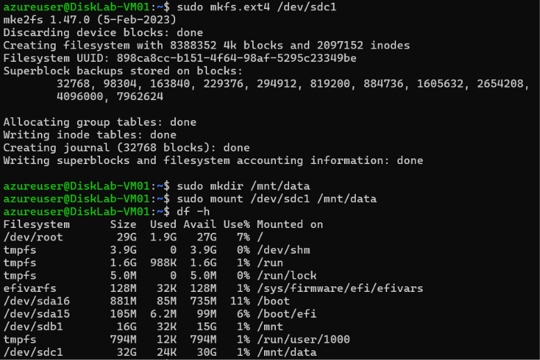

💡 Interesting Observation

Partitioning, formatting and mounting are three separate operations:

1. Partitioning defines a section of the disk.
2. Formatting creates a filesystem.
3. Mounting makes the filesystem accessible through a directory.

A mount performed this way is temporary and may need to be configured again after a reboot.

### Experiment 5 – Write and Read Data

Created a test file on the managed disk:

```bash
echo "Azure Managed Disk Lab 08" | sudo tee /mnt/data/lab-test.txt
```

Read the file:

```bash
cat /mnt/data/lab-test.txt
```

Verified output:

```text
Azure Managed Disk Lab 08
```

The test confirmed that Linux could successfully write data to and read data from the managed disk.

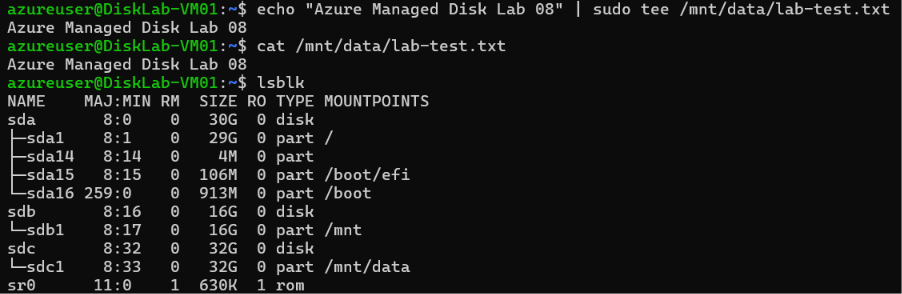

### Experiment 6 – Create a Managed Disk Snapshot

Stopped and deallocated `DiskLab-VM01` before creating the snapshot.

Navigated to:

Virtual Machines
    → DiskLab-VM01
        → Settings
            → Disks
                → DiskLab-DataDisk01

Created a snapshot from the original data disk.

| Setting | Value |
|---|---|
| Snapshot Name | DiskLab-Snapshot01 |
| Resource Group | RG-Disks |
| Region | South Africa North |
| Source Disk | DiskLab-DataDisk01 |

The snapshot was successfully created.

💡 Interesting Observation

A managed disk snapshot captures a point-in-time representation of a disk.

It can subsequently be used as the source for creating another managed disk.

Stopping the VM before the snapshot helped ensure that no further writes were being made to the data disk during the operation.

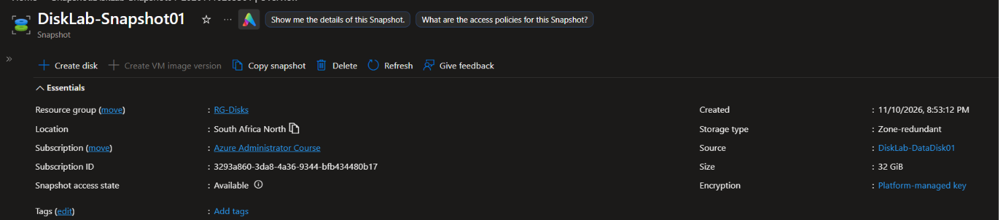

### Experiment 7 – Create a Managed Disk from the Snapshot

Used the snapshot to create a new managed disk.

Navigated to:

Snapshots
    → DiskLab-Snapshot01
        → Create disk

Configuration:

| Setting | Value |
|---|---|
| Disk Name | DiskLab-RestoredDisk01 |
| Resource Group | RG-Disks |
| Region | South Africa North |
| Storage Type | Standard SSD |

Azure successfully provisioned a new managed disk from the snapshot.

The restored disk was independent of the original data disk.

💡 Interesting Observation

A snapshot is not normally attached directly to a VM as a writable data disk.

Instead, a new managed disk is created from the snapshot and then attached to a Virtual Machine.

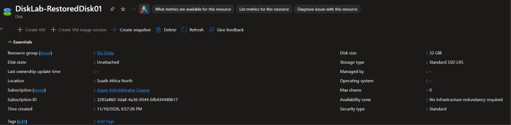

### Experiment 8 – Attach the Restored Disk

Detached the original `DiskLab-DataDisk01` from the VM and attached `DiskLab-RestoredDisk01`.

This allowed the snapshot recovery process to be tested using the restored disk.

Navigated to:

Virtual Machines
    → DiskLab-VM01
        → Settings
            → Disks
                → Detach original disk
                → Attach existing disks
                    → DiskLab-RestoredDisk01

Started the VM and reconnected through SSH.

💡 Interesting Observation

Linux device names changed after the disk attachment changes.

The restored 32 GB disk appeared as `/dev/sda`, while the operating system disk appeared as `/dev/sdb`.

The 16 GB resource disk appeared as `/dev/sdc`.

This reinforced the importance of identifying disks by their size, filesystem and other properties rather than assuming that device names remain constant.

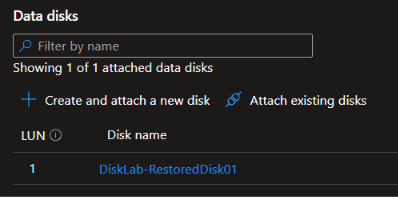

### Experiment 9 – Verify Snapshot Recovery

Identified the restored disk and its filesystem:

```bash
lsblk -f
```

The output showed the restored partition:

```text
/dev/sda
└── /dev/sda1
```

Created a separate mount point:

```bash
sudo mkdir -p /mnt/restored-disk
```

Mounted the restored partition in read-only mode:

```bash
sudo mount -o ro /dev/sda1 /mnt/restored-disk
```

The `-o ro` option mounts the filesystem as read-only, helping prevent accidental changes to recovered data.

Listed the recovered files:

```bash
ls -l /mnt/restored-disk
```

Read the original test file:

```bash
cat /mnt/restored-disk/lab-test.txt
```

Verified output:

```text
Azure Managed Disk Lab 08
```

The original test file was successfully recovered from the restored managed disk.

💡 Interesting Observation

The snapshot preserved the original partition structure, ext4 filesystem and file contents.

Creating a new managed disk from the snapshot allowed the original data to be recovered without modifying the original managed disk.

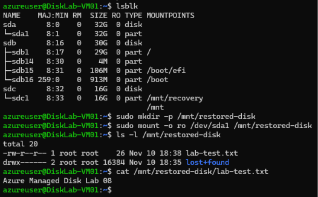

### Experiment 10 – Compare Managed Disk Snapshots and Azure Backup

Compared the purpose and capabilities of Azure Managed Disk Snapshots and Azure Backup.

| Feature | Managed Disk Snapshot | Azure Backup |
|---|---|---|
| Primary Purpose | Point-in-time disk copy | Managed backup and recovery |
| Recovery | Create a managed disk from a snapshot | Restore data or disks through backup recovery workflows |
| Scheduling | Manual or separately automated | Configurable backup policies |
| Retention | Managed through snapshot lifecycle | Configurable retention policies |
| Incremental Backups | Supported | Backup service manages recovery points |
| Centralised Management | Managed through Azure resources | Managed through a Recovery Services vault |
| Protection | Provides a disk recovery point | Provides managed backup protection features |

💡 Interesting Observation

Snapshots and Azure Backup are not interchangeable.

Managed Disk Snapshots are useful for point-in-time disk copies and disk-level recovery.

Azure Backup provides a managed backup service with configurable policies, retention and recovery-point management.

No Azure Backup configuration was performed in this lab. The comparison was theoretical.

## 💰 Cost Considerations

Azure Managed Disks and snapshots incur storage costs based on their configuration and usage.

| Component | Cost Consideration |
|---|---|
| Virtual Machine | Compute charges apply while running |
| Managed Disk | Charges depend on disk SKU and provisioned size |
| Standard SSD | Generally lower cost than higher-performance disk options |
| Snapshot | Snapshot storage incurs charges |
| Restored Managed Disk | Additional managed disk storage charges |
| Public IP | May incur charges depending on SKU and usage |
| Virtual Network | Basic configuration generally has no separate charge |

### Snapshot Storage

Azure managed disk snapshots can use incremental storage.

Incremental snapshots store changes since the previous snapshot rather than repeatedly storing all unchanged data.

This can help reduce snapshot storage consumption.

### Cost Management

Deallocating a VM stops its compute charges, but does not automatically remove charges for:

- Managed disks.
- Snapshots.
- Public IP resources where applicable.
- Other billable resources.

Unused disks and snapshots should be reviewed and deleted when they are no longer required.

## 🛠️ Troubleshooting

### Linux Disk Device Name Changed

During the recovery process, the restored disk did not appear under the device name originally expected.

Initial device mapping:

```text
/dev/sda – OS disk
/dev/sdb – Existing resource disk
/dev/sdc – Original managed data disk
```

After detaching the original disk and attaching the restored disk:

```text
/dev/sda – Restored managed disk
/dev/sdb – OS disk
/dev/sdc – Existing resource disk
```

Resolution:

Used:

```bash
lsblk
```

And:

```bash
lsblk -f
```

These commands helped identify the correct disk using its size, filesystem and partition information.

### Restored File Not Found

Initially attempted to locate the recovered file under `/mnt`:

```bash
cat /mnt/lab-test.txt
```

The file was not found because `/mnt` was associated with the temporary/resource disk rather than the restored managed disk.

The restored disk was subsequently identified as `/dev/sda`.

Resolution:

Created a separate mount point:

```bash
sudo mkdir -p /mnt/restored-disk
```

Mounted the correct partition:

```bash
sudo mount -o ro /dev/sda1 /mnt/restored-disk
```

Verified the recovered file:

```bash
cat /mnt/restored-disk/lab-test.txt
```

The original file contents were successfully recovered.

### Important Storage Safety Considerations

- Always identify the correct disk before running `fdisk` or `mkfs`.
- Do not format a restored disk when the objective is to recover existing data.
- Device names can change after disk attachment operations.
- Use read-only mounting when verifying recovered data where possible.
- Deallocating a VM does not delete its managed disks or snapshots.

## 📚 Lessons Learned

- Azure Managed Disks provide persistent block storage for Azure Virtual Machines.
- Managed data disks can be created independently and attached to existing VMs.
- Azure presents attached disks to Linux as block devices.
- Linux uses tools such as `lsblk` to identify storage devices.
- `fdisk` can be used to create disk partitions.
- `mkfs.ext4` creates an ext4 filesystem.
- Linux filesystems must be mounted before they can be accessed through the directory structure.
- The `df -h` command displays filesystem capacity and usage.
- Managed disk snapshots provide point-in-time disk copies.
- A new managed disk can be created from an existing snapshot.
- Snapshot recovery preserves the partition structure, filesystem and data captured at the time of the snapshot.
- Linux device names can change when disks are detached and reattached.
- Read-only mounting can help protect recovered data during verification.
- Snapshots and Azure Backup serve different recovery and protection requirements.
- Managed disks and snapshots can continue generating storage charges after a VM is deallocated.

## AZ-104 Exam Relevance

This lab covered the following Azure Administrator concepts:

| Exam Topic | Practical Experience |
|---|---|
| Manage Azure compute resources | Deployed and configured a Linux VM |
| Configure VM storage | Created and attached a managed data disk |
| Manage managed disks | Created and inspected managed disks |
| Configure disk snapshots | Created a point-in-time snapshot |
| Restore managed disks | Created a new disk from a snapshot |
| Manage VM disk attachments | Detached and attached managed disks |
| Understand backup solutions | Compared snapshots with Azure Backup |

## References

- Microsoft Learn – [Azure Managed Disks Overview](https://learn.microsoft.com/en-us/azure/virtual-machines/managed-disks-overview)
- Microsoft Learn – [Create a Snapshot of a Managed Disk](https://learn.microsoft.com/en-us/azure/virtual-machines/snapshot-copy-managed-disk)
- Microsoft Learn – [Create a Managed Disk from a Snapshot](https://learn.microsoft.com/en-us/azure/virtual-machines/scripts/create-managed-disk-from-snapshot)
- Microsoft Learn – [Azure Backup Overview](https://learn.microsoft.com/en-us/azure/backup/backup-overview)

**Lab Status: Completed**
